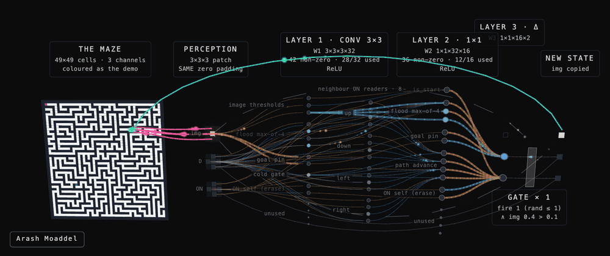
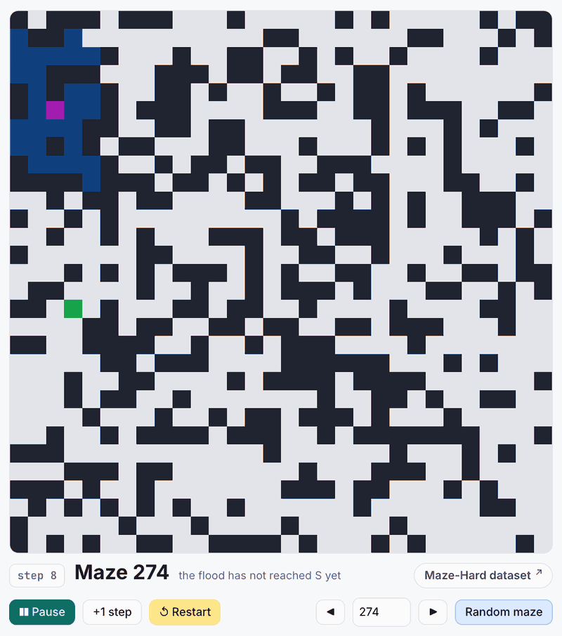

<div align="center">

# Cellular Weight-Space Programming
### 115 Numbers Find Every Shortest Path in Any Maze

**Arash Moaddel** · **Ashkan Moaddel** · **Nina Uller**
<br>
ibiLAB · Luleå University of Technology

[🌐 **Online demo**](#online-demo-placeholder) &nbsp;·&nbsp;
[📄 **Article**](#article-placeholder) &nbsp;·&nbsp;
[🧠 **Network view**](viz/) &nbsp;·&nbsp;
[📝 **Citation**](#-citation)

</div>

---

An AI agent (Claude Opus 5.5, in Claude Code) programmed the weights of a neural cellular automaton directly in weight space, with no training, no data and no gradient descent. The network is a standard neural-cellular-automaton rule (a 3 × 3 convolution followed by two 1 × 1 layers), applied identically in every cell, and only **115 of its 1,458 numbers are non-zero**. Each cell sees nothing but its own pixel and the registers of its four neighbours, yet the grid computes the exact distance to the goal in every corridor cell and lights **every shortest path** from the start, in exactly 2L + 1 steps for a path of L cells. A Maze-Hard edition adds one pointer register and solves **all 1,000 test mazes** of the Maze-Hard benchmark with **208 non-zero weights**. Everything in this repository runs in the browser, computed from those weights.

<table>
<tr>
<td width="50%" align="center"></td>
<td width="50%" align="center"></td>
</tr>
<tr>
<td align="center"><sub><b>Inside one cell.</b> The 3D network view: every unit and weight of the cell's rule, animated while a maze is solved.</sub></td>
<td align="center"><sub><b>Maze-Hard.</b> The 208-weight edition solving test mazes of the 30 × 30 benchmark.</sub></td>
</tr>
</table>

## ✨ Key results

| | |
|---|---|
| 🔢 **Size** | **115** non-zero weights of 1,458 numbers (3 channels, 32 + 16 hidden units) |
| 🎯 **Correctness** | **128 / 128** test mazes exactly right: every distance matches breadth-first search, every shortest path lit, no other cell |
| ⏱️ **Speed** | the path is complete at exactly **2L + 1** parallel steps for a path of L cells; paths up to 1,250 cells |
| 🌫️ **Robustness** | **8 / 8** mazes still solved with noise σ = 0.05 added to every register at every step; cells repair the answer after live edits |
| 🏁 **Maze-Hard** | **1,000 / 1,000** test mazes of [sapientinc/maze-30x30-hard-1k](https://huggingface.co/datasets/sapientinc/maze-30x30-hard-1k), any shortest path and exact match of the answer grid, also with σ = 0.02 noise, using **208** non-zero weights of 3,027 |
| 📏 **Comparison** | 173× fewer weights than the 19,936-weight agent-written looped transformer of Looped Weight-Space Programming; trained Maze-Hard reasoners use 1.8M to 27M parameters |

Nothing was trained. The only thing the Maze-Hard edition takes from the data is the benchmark's tie-break order between equally short paths (down, left, right, up).

## 🕹️ Demos

| | Page | What it does |
|---|---|---|
| 🧠 | [`viz/`](viz/) | **Inside one cell, in 3D.** The cell's network drawn from its weights (input, 3 × 3 gather, two hidden layers, outputs and residual update), each unit labelled with the part of the program it belongs to. Orbit, zoom, click a node for a plain-language explanation. |
| 🧩 | [`maze/`](maze/) | **Solve a maze.** A random 33 × 33 maze solved live by the 115-weight automaton. Draw walls, move the start or the goal, add noise, let only half the cells step, and inspect any cell's hidden units. |
| 🏆 | [`maze-hard/`](maze-hard/) | **Maze-Hard.** Any of the 1,000 test mazes, run by the 208-weight edition (one path, as scored) or the 115-weight automaton (every shortest path), checked against the dataset's answer. |

`index.html` is a hub page that links to all three.

## 🚀 Run locally

No build step and no dependencies: the pages are static files (the 3D view loads three.js from jsDelivr). Serve the folder and open the hub:

```bash
python3 -m http.server 8000   # then open http://localhost:8000
```

## 📁 Repository layout

```
.
├── index.html               hub page: links to the three demos
├── js/
│   ├── automaton.js         the automaton's step in plain JavaScript, from its non-zero weights (window.MazeCA)
│   └── blog.js              the interactive demos (window.MazeBlog): live maze, inspector, Maze-Hard runner
├── models/
│   ├── model-data.js        the maze automaton: 115 non-zero weights of 1,458
│   ├── model-hard-data.js   the Maze-Hard edition: 208 non-zero weights of 3,027
│   └── model-graph.js       the maze automaton as a full graph model (every tensor), for the 3D view
├── maze/index.html          demo: solve a maze in the browser
├── maze-hard/
│   ├── index.html           demo: Maze-Hard, live
│   └── maze-hard-data.js    the 1,000 test mazes, the dataset's answers and per-maze results
├── viz/index.html           the 3D network view (three.js)
└── assets/                  README GIFs, the hub's network-view image, favicon
```

## 👥 Authors

- **Arash Moaddel**, PhD
- **Ashkan Moaddel**, PhD candidate, Luleå University of Technology
- **Nina Uller**, ibiLAB

The weights, the program and the demos were produced by **Claude Opus 5.5** (Anthropic), working as a coding agent in Claude Code, which programmed the weight space directly.

## 📝 Citation

If you use this work, please cite:

```bibtex
@misc{moaddel2026maze,
  title  = {{Cellular Weight-Space Programming: 115 Numbers Find Every Shortest Path in Any Maze}},
  author = {Moaddel, Arash and Moaddel, Ashkan and Uller, Nina},
  year   = {2026},
  month  = nov,
  note   = {Blog post, ibiLAB, Copenhagen},
  url    = {https://github.com/arashmh/Cellular-WSP-Maze}
}
```

## 🙏 Acknowledgements

The Maze-Hard mazes are the public test split of [sapientinc/maze-30x30-hard-1k](https://huggingface.co/datasets/sapientinc/maze-30x30-hard-1k). The 3D view uses [three.js](https://threejs.org/).
